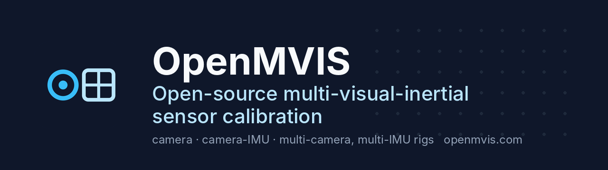

# OpenMVIS



[](https://pypi.org/p/pymvis/)
[](https://pypi.org/p/pymvis/)
[](LICENSE)
[](https://doi.org/10.5281/zenodo.24239182)
[](https://github.com/openmvis/openmvis/actions/workflows/test.yml)
[](https://openmvis.com)

**Open-source Multi-Visual-Inertial Sensor calibration.** A Python toolbox for
**camera** and **camera-IMU** calibration, from a single camera to multi-camera,
multi-IMU rigs, built on GTSAM factor graphs with native SO(3)/SE(3) Lie group
support. OpenMVIS is the project, MVIS is the calibration toolbox, and
`pymvis` is its Python package (import and CLI `mvis`).

[openmvis.com](https://openmvis.com) (documentation) ·
[PyPI](https://pypi.org/p/pymvis/) ·
[Calibench-VI datasets](https://huggingface.co/calibench-vi) ·
[results on real recordings](https://openmvis.com/benchmark/results/)

## What OpenMVIS does

- **Camera calibration** of one or many cameras: intrinsics, distortion,
  extrinsics, camera-camera time offsets and rolling-shutter readout, solved
  jointly on a GTSAM factor graph with analytical Jacobians, Huber loss and an
  outlier-driven second pass with a guardrail against pathological basins. No
  field-of-view overlap is needed between cameras.
  [Guide](https://openmvis.com/guides/camera-calibration/)
- **Camera-IMU calibration** of single or multi cam/IMU rigs: camera-IMU
  extrinsics, time offsets, readout, camera intrinsics, IMU intrinsics
  (`kalibr`, `rpng` or `calyx` model, `Dw`/`Da`, optional `Tg`), biases and the
  base IMU's gyro-accel time offset `t_ga`. Aux IMUs can be solved from their
  gyro alone. One config calibrates a whole family of recordings (`input.bags`).
  [Guide](https://openmvis.com/guides/camera-imu-calibration/) ·
  [multi-sensor rigs](https://openmvis.com/guides/multi-sensor-rigs/)
- **Eight camera models**, mixed freely within one rig and available in both
  modes: `radtan`, `equidistant`, `kb4` (Kannala-Brandt, valid past 90 deg),
  `fov`, `double_sphere`, `eucm`, `ucm`, `omni_radtan` (experimental).
  [Camera model](https://openmvis.com/concepts/camera-model/)
- **Rolling shutter**: readout time per camera, for one camera or jointly in a
  multi-camera rig. [Guide](https://openmvis.com/guides/rolling-shutter/)
- **Apply and verify**: `mvis apply-calib` writes a calibration-corrected copy
  of a bag (IMU intrinsics and biases removed, every stream on the base-IMU
  timeline, `t_ga` corrected); `mvis roundtrip` calibrates, corrects and
  recalibrates and reports PASS/FAIL.
  [Guide](https://openmvis.com/guides/roundtrip/)
- **Inputs**: image folders, timestamped images, ROS1 and ROS2 bags (no ROS
  install), EuRoC/ASL folders; AprilGrid, chessboard and ArUco boards; Kalibr
  `camchain` read and write; streaming detection, so memory does not grow with
  the recording. [Configuration](https://openmvis.com/reference/configuration/)
- **Outputs**: YAML calibrations, JSON results, self-contained HTML reports
  (reprojection analysis, motion excitation, detection statistics, timing) and
  an optional Rerun 3D view.
  [Result formats](https://openmvis.com/reference/result-formats/)
- **Datasets**: `mvis datasets` lists, downloads and verifies the Calibench-VI
  recordings on Hugging Face. [Datasets](https://openmvis.com/datasets/)
- **Pure Python**: `pip install`, no C++ build or ROS workspace. Linux and
  macOS, Python 3.11 and 3.12 (GTSAM ships no wheels below cp311; `numpy<2`
  has no 3.13 wheel). Windows: tentative; it has run there, but GTSAM ships no
  Windows wheels on PyPI, so install steps aren't written up yet.
  [Requirements](https://openmvis.com/getting-started/requirements/)

The validation behind these claims is on
[openmvis.com](https://openmvis.com/benchmark/methodology/) and in `doc/`.

## MVIS vs Kalibr vs Basalt

✅ supported · ❌ not supported

| Feature | MVIS | Kalibr | Basalt |
|---|:---:|:---:|:---:|
| **Install and platforms** | | | |
| `pip install` | ✅ | ❌ | ❌ |
| No ROS needed | ✅ | ❌ | ✅ |
| Linux | ✅ | ✅ | ✅ |
| macOS | ✅ | ❌ | ✅ |
| Windows (tentative) | ✅ | ❌ | ❌ |
| **Inputs** | | | |
| ROS 1 bags | ✅ | ✅ | ✅ |
| ROS 2 bags | ✅ | ❌ | ❌ |
| EuRoC folders | ✅ | ❌ | ✅ |
| Image folders | ✅ | ❌ | ❌ |
| **Boards** | | | |
| AprilGrid | ✅ | ✅ | ✅ |
| ArUco | ✅ | ❌ | ❌ |
| Chessboard | ✅ | ✅ | ❌ |
| Circle grid | ❌ | ✅ | ❌ |
| **Camera models** | | | |
| RadTan | ✅ | ✅ | ❌ |
| Equidistant / KB4 | ✅ | ✅ | ✅ |
| FOV | ✅ | ✅ | ❌ |
| Double Sphere (DS) | ✅ | ✅ | ✅ |
| EUCM | ✅ | ✅ | ✅ |
| UCM | ✅ | ❌ | ✅ |
| Omni + RadTan | ✅ | ✅ | ❌ |
| **Cameras** | | | |
| More than two cameras | ✅ | ✅ | ❌ |
| Cameras without shared view | ✅ | ❌ | ❌ |
| Rolling shutter, one camera | ✅ | ✅ | ❌ |
| Rolling shutter, joint readout across cameras | ✅ | ❌ | ❌ |
| **Time and IMU** | | | |
| Camera–IMU time offset | ✅ | ✅ | ✅ |
| Camera–camera time offset | ✅ | ❌ | ❌ |
| IMU intrinsics (scale, misalignment) | ✅ | ❌ | ✅ |
| Gyro–accel time offset (t_ga) | ✅ | ❌ | ❌ |
| **Output** | | | |
| Self-contained HTML report | ✅ | ❌ | ❌ |

How each tool works:

| | MVIS | Kalibr | Basalt |
|---|---|---|---|
| **Optimizer** | GTSAM factor graph (LM) | Custom `aslam_optimizer` | Custom LM + Gauss-Newton |
| **Trajectory** | Per-frame pose + SLERP | B-spline (order 6) | B-spline SE(3) (order 5) |
| **Outlier rejection** | Two passes: P99, then a warm-start rerun | One pass, Blake-Zisserman | One pass, Huber |
| **Output files** | YAML + HTML report | YAML + TXT + PDF | JSON (cereal) |

Measured side by side on the same public recordings, every parameter as
median ± sd across recordings:
[openmvis.com/benchmark/results](https://openmvis.com/benchmark/results/).
The design comparison is on
[Comparison vs Kalibr / Basalt](https://openmvis.com/getting-started/comparison/).
Kalibr and Basalt are only called as external programs for those comparisons;
neither is distributed with MVIS.

## Get started

Python 3.11 or 3.12, on Linux or macOS (Windows tentative):

```bash
pip install "pymvis[apriltag,ros1]"      # AprilGrid boards + ROS1 bag input
mvis check --env --smoke                 # verify the install
```

Optional extras: `apriltag` (AprilGrid), `aruco` (opencv-contrib), `ros1` (ROS1
bags, no ROS needed), `mcap` (MCAP episodes), `viz` (Rerun viewer), `dev`
(pytest). For development, clone and `pip install -e ".[apriltag,aruco,ros1,dev]"`.

A first calibration on a VI-Rig recording (gated on the Hub: accept the terms,
then `hf auth login`):

```bash
mvis datasets download --select mvis_4imus_3cams/april_01   # ~7 GB to $MVIS_DATASETS
mvis check -c examples/regression/mvis_4imus_3cams/cam_imu_april_01.yaml
mvis run   -c examples/regression/mvis_4imus_3cams/cam_imu_april_01.yaml
```

The run writes the calibration YAML, a JSON result and an HTML report next to
the config's `output_file`. Everything else is on openmvis.com:

- [Installation](https://openmvis.com/getting-started/installation/) and
  [Quickstart](https://openmvis.com/getting-started/quickstart/)
- [Guides](https://openmvis.com/guides/board-setup/): board setup, calibration
  motion, camera, camera-IMU, rolling shutter, multi-sensor rigs, round trip,
  simulation
- [Configuration](https://openmvis.com/reference/configuration/),
  [CLI](https://openmvis.com/reference/cli/),
  [Python API](https://openmvis.com/reference/python-api/),
  [result formats](https://openmvis.com/reference/result-formats/)
- [Datasets](https://openmvis.com/datasets/), the
  [Device wiki](https://openmvis.com/devices/) and
  [FAQ & troubleshooting](https://openmvis.com/about/faq/)
- In this repository: `doc/camera_models.html` (projection, unprojection,
  Jacobians), `doc/estimate_config.md`, `doc/testing.md`,
  `examples/configs/`.

MVIS is research code, maintained on a best-effort basis. GTSAM 4.2 wheels need
`numpy<2`, so `pyproject.toml` pins NumPy and OpenCV accordingly.

## Citation

If you use MVIS, please cite the MVIS paper (see `CITATION.cff`):

```bibtex
@article{Yang2024MVIS,
  author  = {Yang, Yulin and Geneva, Patrick and Huang, Guoquan},
  title   = {Multi-visual-inertial system: Analysis, calibration, and estimation},
  journal = {The International Journal of Robotics Research},
  year    = {2024},
  volume  = {43},
  number  = {13},
  pages   = {1995--2026},
  doi     = {10.1177/02783649241245726}
}
```

and the project, by its Zenodo concept DOI (resolves to the latest release; each release also
has a version DOI, `10.5281/zenodo.24239183` for v0.1.0):

```bibtex
@misc{openmvis,
  title  = {{OpenMVIS}: open-source multi-visual-inertial sensor calibration},
  author = {{OpenMVIS Contributors}},
  year   = {2026},
  doi    = {10.5281/zenodo.24239182},
  url    = {https://openmvis.com}
}
```

If your results depend on the Calibench-VI datasets, cite them too; the entries are on
[openmvis.com/about/contributors](https://openmvis.com/about/contributors/#citing-the-datasets-calibench-vi).

## Contributors

- **Yulin Yang** ([yangyulin](https://github.com/yangyulin)) — author and maintainer.
- **Yuantai Zhang** ([Yuantai-Z](https://github.com/Yuantai-Z)) — camera-only pipeline fixes,
  the ROS1 recalibration tool and RealSense D435i recordings.
- **Nerako Lee** ([nerakoo](https://github.com/nerakoo)) — RealSense D455/D456 recordings and
  calibration runs for the Device wiki and the Calibench-VI community datasets.

The full list is in [AUTHORS](AUTHORS); the people behind the datasets and the MVIS paper are on
[openmvis.com/about/contributors](https://openmvis.com/about/contributors/).

## Contributing

Issues and pull requests are welcome; see
[CONTRIBUTING.md](https://github.com/openmvis/openmvis/blob/main/CONTRIBUTING.md).

## License

MVIS is released under
[GPL-3.0-only](https://github.com/openmvis/openmvis/blob/main/LICENSE): free for
everyone, including companies and commercial use, as long as software that
includes or is derived from MVIS is released under the GPL. For use in
closed-source products, a commercial licence is available; see
[COMMERCIAL-LICENSE.md](https://github.com/openmvis/openmvis/blob/main/COMMERCIAL-LICENSE.md)
(licensing@openmvis.com). Calibration results you compute with MVIS are yours to
publish, including commercially.
